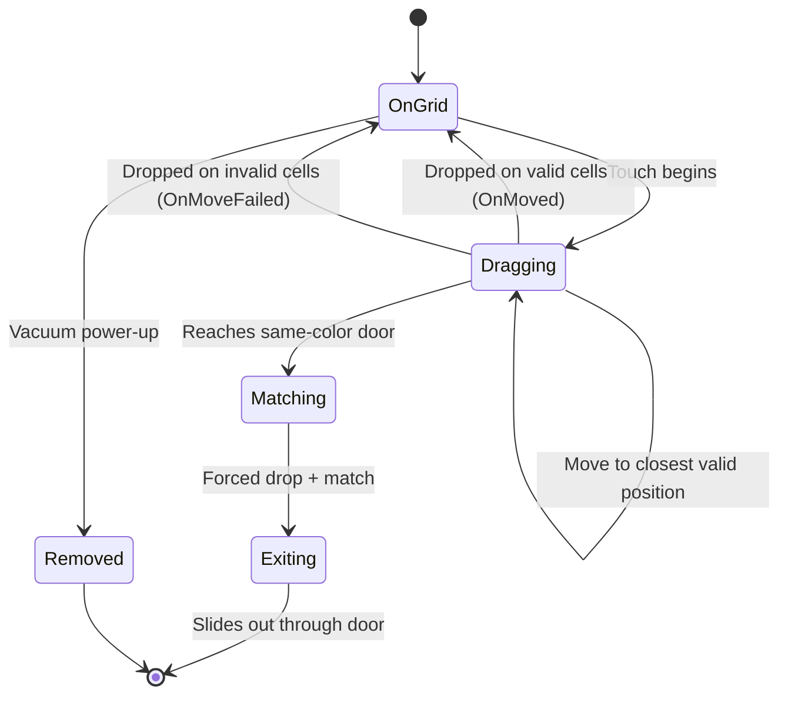
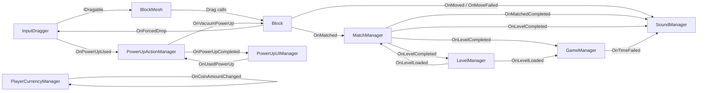

<div align="center">

# 🟦 Color Block Jam — Unity

A Color Block Jam-style sliding puzzle clone built in Unity 2022.3 (C#), featuring grid-based drag & drop, multi-cell block shapes, color-matched exit doors, a vacuum power-up, and a data-driven level system powered by ScriptableObjects.


https://github.com/user-attachments/assets/f3cb3b58-32aa-441f-be71-dc97897db104


</div>

## 🎮 About

A from-scratch clone of the Color Block Jam puzzle. Colored blocks sit on a grid surrounded by walls. Colored doors are cut into the walls. Drag each block to the door of its own color and it slides out of the board. Clear every block before the timer runs out.

The project focuses on clean, readable gameplay code: blocks share an abstract base class, input is decoupled through an `IDragable` interface, gameplay systems communicate through static C# events, and the whole board (grid, doors, walls, corners, camera) is generated at runtime from a `LevelConfig` ScriptableObject.

## ✨ Features

- 👆 Touch drag & drop with smooth, grid-snapped movement.
- 🧩 Multi-cell blocks: any shape can be built by offsetting extra meshes from a pivot cell.
- ➡️ Limited blocks that can only slide along one axis (horizontal or vertical), shown with an arrow icon.
- 🚪 Colored doors of configurable length and direction, matched only by same-color blocks that fit through.
- 🧱 Procedural walls and corners generated around the grid, leaving gaps where doors are.
- 🚧 Obstacle-aware movement: blocks cannot pass through other blocks or walls.
- ⏱️ Per-level countdown timer with a fail state.
- 🌀 Vacuum power-up that removes every block of a chosen color.
- 🪙 Coin rewards and level progress saved with `PlayerPrefs`.
- ✨ Outline highlight on the dragged block via Highlight Plus.
- 🎬 Door and block animations with DOTween, plus pooled particle effects.
- 🔊 Sound effects for moves, failed moves, matches, level completion, and time out.
- 📐 Camera that repositions itself to fit any grid size.
- 🗺️ Data-driven levels via ScriptableObjects, with 6 sample levels.

## 🕹️ Gameplay

### Controls

| Action | Input |
|---|---|
| Pick up a block | Touch a block |
| Move the block | Drag |
| Drop the block | Release |
| Use the vacuum | Tap the power-up button, then tap a block |

### Game Rules

1. The board is a grid. Each block occupies one or more cells.
2. Blocks can be dragged to any free position they can reach without overlapping another block or wall.
3. A block can leave the board through a door of the same color.
4. The door must be wide enough for the block. Every row (or column) the block occupies has to line up with the door's cells.
5. When a block reaches its matching door while dragging, it is dropped automatically and slides out.
6. Limited blocks can only move along the axis shown by their arrow.
7. Dropping a block on an invalid position sends it back to where it started.
8. Clearing every block completes the level and awards a random coin reward.
9. If the timer reaches zero, the level is failed and can be retried.

### Power-up: Vacuum

1. Tap the vacuum button.
2. Tap any block.
3. Every block of that color shrinks and is sucked into the vacuum, counting as matched.
4. Other input is paused while the power-up is active, and the power-up UI returns once the animation finishes.

### Levels

The project ships with 6 sample levels, from a 3×3 board with a single block up to larger boards such as 5×7 and 8×5, with multiple doors, limited blocks, and multi-cell shapes. Every level has a 60-second timer.

## 🧠 How It Works

### Block Lifecycle



### Drag Algorithm

1. The touch position is projected onto the grid plane and snapped to a node.
2. For limited blocks, one axis of the position is locked to the block's current position.
3. The block searches a small radius around the grabbed node for the closest valid placement:
   - Every mesh must be in bounds.
   - Every mesh must be on an unoccupied node.
   - Every mesh must be free of obstacles.
4. Obstacles are detected with a `SphereCast` from each mesh toward the target, ignoring the block's own colliders.
5. The block moves toward that position with a smooth lerp.
6. On release, the block snaps to its final nodes, or returns to the saved ones if the drop is invalid.

### Door Matching

While dragging, each mesh checks for a nearby door using an `OverlapSphere` on the door layer.

A door counts as a match when:

- Its color equals the block's color.
- The number of unique rows/columns the block covers is no larger than the door length.
- Every one of those rows/columns lines up with one of the door's cells.

If the block is still being dragged, a forced drop is triggered. Once it is dropped, the nodes are freed and `OnMatched` is raised.

### Level Generation

`Grid.CreateGrid()` builds everything from the current `LevelConfig` in order:

1. Nodes
2. Doors
3. Blocks
4. Corners
5. Ground
6. Walls
7. Camera position

Wall segments are generated per edge and automatically split around door openings.

## 🏗️ Architecture

Systems communicate through static C# events instead of referencing each other directly.

### Event Flow



### Events

| Event | Raised When |
|---|---|
| `Block.OnMoved` | A block is dropped on a valid position. |
| `Block.OnMoveFailed` | A block is dropped on an invalid position and returns. |
| `Block.OnForcedDrop` | A dragged block reaches its door and must drop immediately. |
| `Block.OnMatched` | A block exits through a door or is removed by the vacuum. |
| `MatchManager.OnMatchedCompleted` | A match animation sequence should play audio/feedback. |
| `MatchManager.OnLevelCompleted` | All blocks have been matched. |
| `LevelManager.OnLevelLoaded` | A level has been generated. |
| `GameManager.OnTimeFailed` | The timer reached zero. |
| `PowerUpUIManager.OnUsedPowerUp` | A power-up button is pressed. |
| `InputDragger.OnPowerUpUsed` | A block is chosen as the power-up target. |
| `PowerUpActionManager.OnPowerUpCompleted` | A power-up animation finishes. |
| `PlayerCurrencyManager.OnCoinAmountChanged` | The coin total changes. |

### Core Systems

| System | Responsibility |
|---|---|
| `GameManager` | `Idle` / `Play` state, countdown timer, level complete and fail UI. |
| `LevelManager` | Picks the config for the saved level, regenerates the grid, handles next/retry buttons and rewards. |
| `Grid` | Generates nodes, doors, blocks, walls, corners, ground and camera. Provides snapping and lookup helpers. |
| `Node` | One grid cell: grid position, world position, occupying block. |
| `Block` | Abstract base: node bookkeeping, valid-position search, door matching, vacuum and exit animation. |
| `FreeBlock` / `LimitedBlock` | Concrete blocks. Limited blocks lock movement to one axis and show a direction arrow. |
| `BlockMesh` | One cell of a block: `IDragable` implementation, door overlap and obstacle spherecast. |
| `Door` / `Wall` | Edge pieces sized and oriented from level data. |
| `InputDragger` | Touch input, raycasting, plane projection and power-up target selection. |
| `MatchManager` | Counts matches, plays door particles and detects level completion. |
| `PowerUpActionManager` / `PowerUpUIManager` | Vacuum power-up flow and UI. |
| `PlayerCurrencyManager` | Coin storage and display. |
| `SaveLoadManager` | Stores the current level in `PlayerPrefs`. |
| `SoundManager` | Plays sound effects in response to events. |
| `ObjectPool` | Named pools with automatic expansion. |

### Design Decisions

- **Abstract `Block`:** Shared logic lives in one base class. `FreeBlock` and `LimitedBlock` only differ in how they constrain dragging.
- **`IDragable` interface:** Input code works with any draggable, not with a specific block type.
- **Cell-based blocks:** A block is a parent object with one `BlockMesh` child per cell, so any shape works without custom colliders.
- **Node occupancy:** Nodes track their block, so placement checks are simple lookups instead of physics queries.
- **Save and restore on drag:** Nodes are released at drag start and restored if the drop fails, keeping the grid consistent.
- **Everything generated from data:** Grid size, node size, blocks, doors, and timer all come from `LevelConfig`.
- **Auto-fit camera:** Camera height and distance scale with the grid size.
- **Object pooling:** Door particle effects are pooled instead of instantiated.
- **XML documentation:** Public methods are documented with summary comments.

## 📂 Project Structure

```text
Assets/
└── Scripts/
    ├── Block/                 # Block, FreeBlock, LimitedBlock, BlockMesh, Door, Wall
    ├── Configs/               # LevelConfig and level assets (Level 1–6)
    ├── Grid/                  # Grid and Node
    ├── Helpers/               # Helpers, Singleton, ObjectPool
    ├── Interface/             # IDragable
    ├── Managers/              # Game, Level, Match, PowerUp, Currency, Save, Sound
    └── Player/                # InputDragger
```

## 🚀 Getting Started

### Requirements

- Unity 2022.3.51f1
- TextMeshPro
- DOTween
- Highlight Plus (outline effect)

### Installation

1. Clone the repository.
2. Open Unity Hub.
3. Select **Add → Add project from disk**.
4. Select the cloned project folder (use Unity 2022.3.51f1).
5. Import DOTween and Highlight Plus if they are not included in the repository.
6. Open the main scene inside `Assets/Scenes/`.
7. Press Play to start the game.

> Gameplay input uses **touch** (`Input.GetTouch`). Use the **Device Simulator** in the Game view or build to a mobile device to play.

## ⚙️ Configuring Levels

### Level Configuration

Create a `LevelConfig` asset (**Create → ScriptableObjects → LevelConfig**) to configure:

- Grid size and node size.
- Time limit in seconds.
- Blocks: pivot grid position, extra mesh offsets (shape), color, and optional axis limit.
- Doors: grid position, length, color, and direction (`Up`, `Down`, `Left`, `Right`).

Then add the asset to the `LevelManager`'s config list. Levels play in order and loop after the last one.

### Block Shapes

A block's shape is defined by `MeshPositions`, a list of cell offsets from the pivot (`GridPosition`).

| Shape | Offsets |
|---|---|
| Single cell | `(0,0)` |
| Horizontal pair | `(0,0)`, `(1,0)` |
| L-shape | `(0,0)`, `(1,0)`, `(0,1)` |

Set `LimitedDir` to `Horizontal` or `Vertical` to restrict movement, or `None` for a free block.

### Colors

Each color is a `MatchColor` value (`Blue`, `Green`, `Red`, `Yellow`) paired with a material. Blocks and doors use the same `ColorData` struct so matching is a simple enum comparison.

#### Adding a New Color

1. Add a value to the `MatchColor` enum.
2. Create a material for it.
3. Use the new `ColorData` on blocks and doors in your level configs.

## 🧰 Tech Stack

| Area | Tool |
|---|---|
| Engine | Unity 2022.3.51f1 |
| Language | C# |
| Animation | DOTween |
| Outlines | Highlight Plus |
| Input | Unity legacy Input Manager (touch) |
| UI | TextMeshPro |
